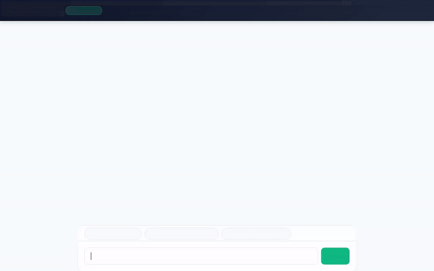

# 🏋️‍♂️ Fitness Coach AI

A conversational AI assistant built with Google's **Agent Development Kit (ADK)** that helps fitness enthusiasts plan workouts, track progress, manage exercise libraries, and calculate fitness metrics with rich interactive **A2UI cards** and **Generative Media**.



---

## 🌟 Key Features

* **🧠 Cross-Session Memory (Vertex AI Memory Bank)**
  * Automatically recalls user allergies (e.g. peanuts, dairy, gluten), fitness goals, experience level, and physical limitations across past sessions using `PreloadMemoryTool` and background memory generation callbacks.
* **🏋️‍♂️ Firestore Exercise & Workout History Database**
  * **Exercise Lookup**: Filter exercise library catalog by muscle group (`Chest`, `Legs`, `Back`, `Shoulders`, etc.).
  * **Exercise Details**: Retrieve detailed execution steps, difficulty ratings, and required equipment.
  * **Exercise Management**: Add new exercises or update existing database entries.
  * **Workout Logging**: Log completed workout sets, reps, weights, and session notes directly to Firestore.
* **📱 Interactive A2UI Component Cards**
  * Renders dynamic, responsive UI cards, columns, rows, text hierarchies, and badges directly in the chat window using A2UI (v0.8 Basic Catalog).
* **🎨 Generative Media Tools (Image & Video)**
  * **Motivational Visuals**: Generates exercise form guides and motivational graphics using `gemini-3.1-flash-lite-image`.
  * **Exercise Videos**: Generates short exercise demonstration video clips using `gemini-omni-flash-preview` in the `global` region.
  * **Cloud Storage & Artifacts**: Uploads generated media directly to a public Google Cloud Storage bucket and saves video blobs to the ADK Playground Artifacts panel.
* **🧮 Python Execution Sandbox**
  * Executes Python code in a secure `AgentEngineSandboxCodeExecutor` environment to compute One-Rep Max (1RM), target heart rate zones, and macro/calorie breakdowns.
* **🥗 Nutritional Information Search**
  * Queries the Open Food Facts database for calorie, protein, carbohydrate, and fat metrics per 100g of foods and supplements.

---

## ☁️ Google Cloud Architecture

* **Vertex AI Agent Engine / Agent Runtime**: Hosts and orchestrates the ADK root agent (`gemini-2.5-flash`).
* **Vertex AI Memory Bank**: Manages durable long-term memory extraction and retrieval.
* **Google Cloud Firestore**: NoSQL database for exercise catalog records (`exercises` collection) and user workout logs (`workout_logs` collection).
* **Google Cloud Storage**: Public assets bucket hosting generated workout images and video files.
* **Google Cloud Run**: Hosts the production FastAPI proxy and branded chat web frontend.

---

## 📁 Repository Structure

```text
├── app/
│   ├── agent.py               # Root ADK agent definition, tool implementations, and callbacks
│   ├── a2ui_utils.py          # A2UI after_model_callback transformer
│   └── __init__.py
├── frontend/
│   ├── main.py                # FastAPI proxy forwarding browser requests to agent over A2A
│   ├── static/
│   │   └── index.html         # Branded chat UI with A2UI renderer & prompt chips
│   └── requirements.txt
├── agents-cli-manifest.yaml   # Manifest for agents-cli deployment configuration
├── project_brief.md           # Project specification brief
├── demo.gif                   # Recorded video demonstration (looping GIF)
└── README.md                  # Project documentation
```

---

## 🚀 Local Setup & Development

### 1. Prerequisites

Ensure you have Python 3.10+ installed and Google Cloud authentication configured:

```bash
gcloud auth login
gcloud auth application-default login
gcloud config set project <YOUR_GCP_PROJECT_ID>
```

### 2. Install Dependencies

```bash
pip install -r requirements.txt
pip install -r frontend/requirements.txt
```

### 3. Run Local Proxy & Web Frontend

Export your target environment variables and launch the FastAPI server:

```bash
export GOOGLE_CLOUD_PROJECT="<YOUR_GCP_PROJECT_ID>"
export GOOGLE_CLOUD_LOCATION="us-central1"
export AGENT_ENGINE_RESOURCE_NAME="projects/<PROJECT_NUMBER>/locations/us-central1/reasoningEngines/<ENGINE_ID>"
export AGENT_DIRECTORY="app"

cd frontend
python main.py
```

### 4. Run ADK Local Web Playground (Alternative)

To test directly using ADK's built-in developer playground:

```bash
adk web --memory_service_uri=agentengine://<ENGINE_ID>
```

---

## 🚢 Deployment Commands

### Deploy Agent to Agent Runtime

```bash
agents-cli deploy \
  --project <YOUR_GCP_PROJECT_ID> \
  --region us-central1 \
  --no-confirm-project
```

### Deploy Frontend to Cloud Run

```bash
gcloud run deploy fitness-coach-frontend \
  --source frontend \
  --region us-central1 \
  --allow-unauthenticated \
  --set-env-vars AGENT_ENGINE_RESOURCE_NAME="projects/<PROJECT_NUMBER>/locations/us-central1/reasoningEngines/<ENGINE_ID>",AGENT_DIRECTORY="app"
```
